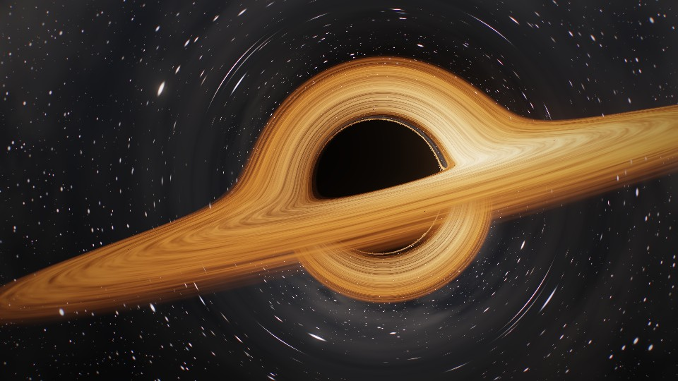
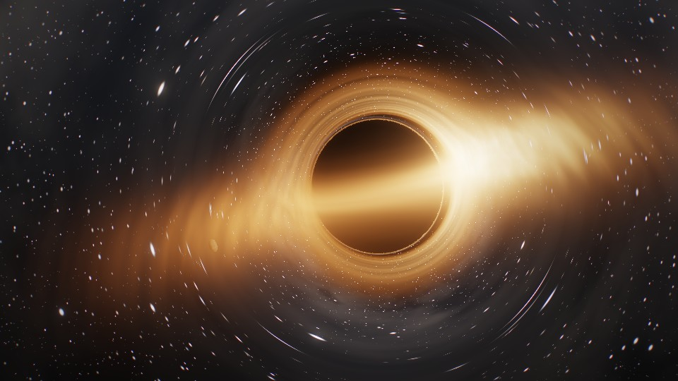
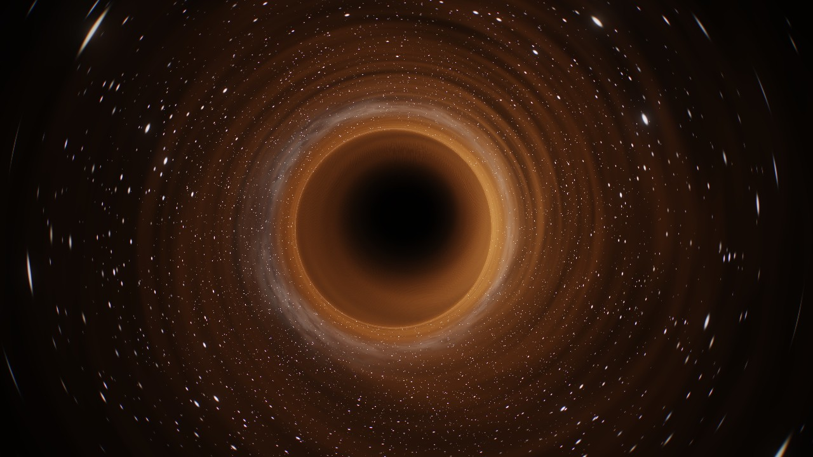
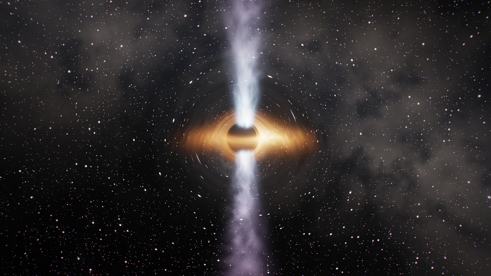
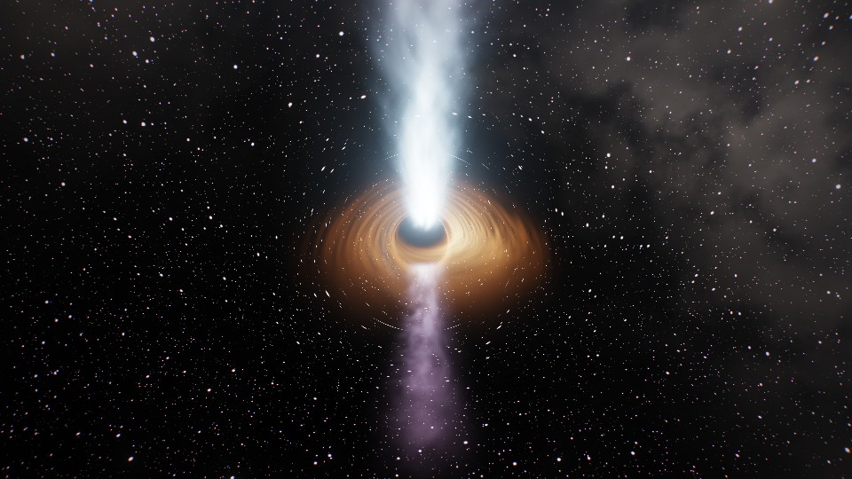
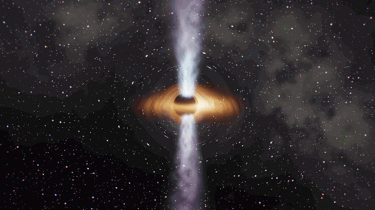
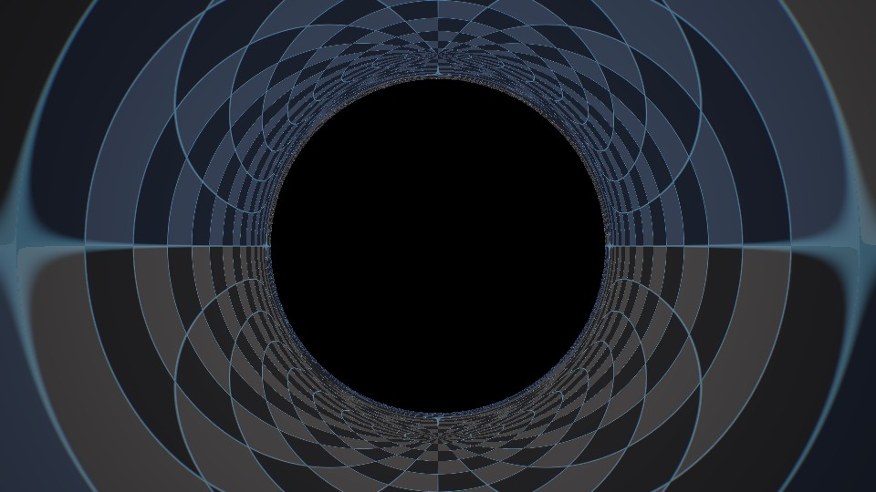
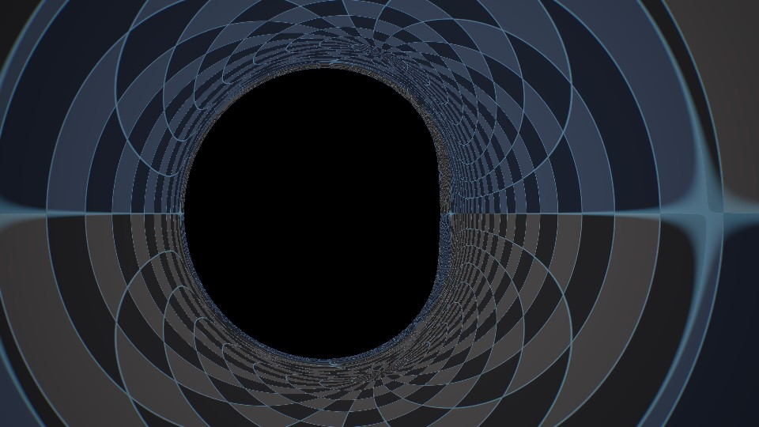
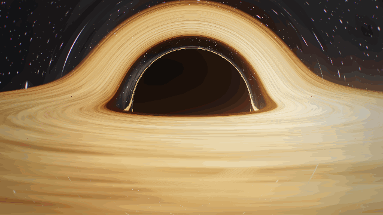
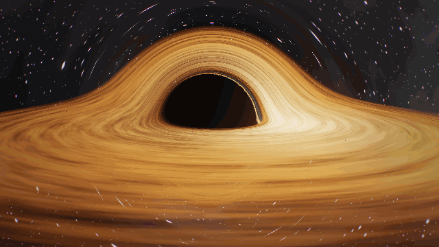

<p align="center">
  
</p>

<p align="center">
  
  
  
  
</p>

<p align="center">
  
</p>

<p align="center"><sub><code>R_CAM 19.00 rₛ</code> · <code>INCLINATION 86.0°</code> · <code>CLOCK RATE 0.9733×</code> · <code>PROBE τ/t 0.9129</code></sub></p>

<br>

Every pixel is a photon traced **backwards** from the camera through the curved spacetime of a **spinning (Kerr) black hole**. The arched halo, the thin photon ring and the lopsided glow of the disk are not painted on. They fall out of the geodesic equation, integrated on the GPU at interactive frame rates.

Built for learning: switch gravity off for light, swap the stars for a coordinate grid, draw the photon sphere and ISCO on the disk plane, and watch the readouts for how fast your clock runs.

<br>

## `00` &nbsp;LAUNCH

```bash
python -m http.server 5179
```

Then open **http://localhost:5179**. Opening `index.html` directly also works. Any browser with WebGL 2 will do (Chrome, Edge, Firefox, Safari 15+).

<br>

## `01` &nbsp;OBSERVATIONS

<sub>Rendered with the thin-sheet disk model, which shows the lensing most clearly.</sub>

<table>
  <tr>
    <td width="50%"></td>
    <td width="50%"></td>
  </tr>
  <tr>
    <td><sub><code>T → ∞</code> &nbsp;KEPLERIAN FLOW · INNER GAS LAPS THE OUTER DISK</sub></td>
    <td><sub><code>φ 0 → 2π</code> &nbsp;FREE CAMERA · ORBIT, PAN, ZOOM, ROLL</sub></td>
  </tr>
</table>

<table>
  <tr>
    <td width="50%"></td>
    <td width="50%"></td>
  </tr>
  <tr>
    <td><sub><code>LIGHT BENDING 0%</code> &nbsp;FLAT SPACE · WHAT YOU WOULD NAIVELY EXPECT</sub></td>
    <td><sub><code>LIGHT BENDING 100%</code> &nbsp;THE FAR SIDE OF THE DISK, LIFTED OVER THE SHADOW</sub></td>
  </tr>
</table>

<p align="center">
  
</p>
<p align="center"><sub><code>GRID</code> &nbsp;BACKGROUND + <code>EQUATORIAL GUIDES</code> · CYAN = PHOTON SPHERE 1.5 rₛ · AMBER = ISCO 3 rₛ</sub></p>

<table>
  <tr>
    <td width="50%"></td>
    <td width="50%"></td>
  </tr>
  <tr>
    <td><sub><code>BLACKBODY</code> · <code>DOPPLER 100%</code> &nbsp;APPROACHING SIDE BEAMED, RECEDING SIDE DIMMED</sub></td>
    <td><sub><code>R_CAM 4.2 rₛ</code> &nbsp;CLOSE PASS · THE SHADOW FILLS THE SKY</sub></td>
  </tr>
  <tr>
    <td></td>
    <td></td>
  </tr>
  <tr>
    <td><sub><code>INCLINATION 3°</code> &nbsp;POLAR · THE PHOTON RING AS A PERFECT CIRCLE</sub></td>
    <td><sub><code>PRESET 1</code> &nbsp;GARGANTUA FRAMING · WITH ORBITING PROBE</sub></td>
  </tr>
</table>

<br>

## `02` &nbsp;EXPERIMENTS

### Thicken the disk &nbsp;<sub><code>DISK MODEL</code></sub>

<table>
  <tr>
    <td width="50%"></td>
    <td width="50%"></td>
  </tr>
  <tr>
    <td><sub><code>THIN SHEET</code> &nbsp;ZERO THICKNESS · CRISP LENSED IMAGES</sub></td>
    <td><sub><code>THICK · H/R 0.10</code> &nbsp;GLOWING GAS · HAZE · PARTLY TRANSPARENT</sub></td>
  </tr>
</table>

<p align="center">
  
</p>
<p align="center"><sub><code>EHT VIEW · 17°</code> &nbsp;a/M 0.94 · H/R 0.30 · THE SHADOW AS A DARK DIP IN THE GLOW</sub></p>

The thick model replaces the sheet with a volume of hot gas. Its density falls off as a Gaussian above and below the plane, with scale height H = (H/R)·R, plus an optional broader **haze**. Each ray integrates emission and absorption step by step through the Kerr metric. The gas is mostly optically thin, so it glows more than it blocks, and the shadow becomes a dark depression in the light instead of a hard edge. Gas inside the ISCO keeps glowing as it plunges in, which is why the Event Horizon Telescope images look like a hazy ring. **EHT view** (key 5) looks down at 17°, the angle we see M87* from.

### Launch the jets &nbsp;<sub><code>J</code></sub>

<table>
  <tr>
    <td width="50%"></td>
    <td width="50%"></td>
  </tr>
  <tr>
    <td><sub><code>SIDE-ON</code> &nbsp;TWIN JETS ALONG THE SPIN AXIS · γ 2</sub></td>
    <td><sub><code>TILTED 31°</code> &nbsp;APPROACHING JET BEAMED · COUNTER-JET DIMMED</sub></td>
  </tr>
</table>

<p align="center">
  
</p>

Jets are optically thin plasma flowing out along the spin axis at Lorentz factor γ (adjustable; β = √(1 − 1/γ²)). The column widens with height and fades out; bright knots ride outward at βc. Every jet sample is ray-traced through the Kerr metric, so the jet behind the hole bends into view. Each sample is weighted by the exact gravitational and frame-dragging shift times the Doppler factor of the flow (I ∝ g³). The approaching jet blazes and the counter-jet nearly vanishes, as in M87. Knots are drawn at their retarded time, which produces apparent superluminal motion on the approaching side. Power follows the hole's spin (Blandford–Znajek, P ∝ a²): at a/M = 0 the jets switch off.

### Spin the hole &nbsp;<sub><code>SPIN a/M</code></sub>

<table>
  <tr>
    <td width="50%"></td>
    <td width="50%"></td>
  </tr>
  <tr>
    <td><sub><code>a/M 0</code> &nbsp;SCHWARZSCHILD · ROUND SHADOW</sub></td>
    <td><sub><code>a/M 0.998</code> &nbsp;KERR · FLATTENED WHERE THE HOLE TURNS TOWARD YOU</sub></td>
  </tr>
</table>

<p align="center">
  
</p>
<p align="center"><sub><code>a/M 0 → 0.998</code> &nbsp;INNER EDGE LOCKED TO THE ISCO · 3 rₛ → 0.62 rₛ</sub></p>

Real black holes spin, and spin changes almost everything near the hole. The horizon shrinks from 1 to 0.53 rₛ. Gas orbiting with the spin can come much closer (the ISCO falls from 3 to 0.62 rₛ), so the disk gets hotter and brighter near the hole. Spacetime is dragged around: inside the **ergosphere** nothing can hold still against the distant stars, and a static camera there is swept along. Light moving with the rotation can pass closer than light moving against it, which flattens one side of the shadow into a "D". The default is a/M = 0.6, the value Interstellar's effects team used for Gargantua.


<sub>The probe, inspector and observer images below use a/M = 0, so their numbers match the Schwarzschild formulas.</sub>

### Flash the disk &nbsp;<sub><code>X</code></sub>

<p align="center">
  
</p>
<p align="center"><sub><code>FLARE</code> &nbsp;ONE EVENT · SEEN OVER THE SHADOW FIRST, THEN AGAIN BELOW IT ~3 rₛ/c LATER</sub></p>

Light that takes the long way round arrives late. Every ray integrates its own light travel time, $dt/d\zeta$, alongside its path, and the disk is drawn as it was when that light left it. **Flash** sets off a short flare in the gas behind the hole and slows time to ×0.25. The first image appears lifted over the top of the shadow. A few rₛ/c later a second, fainter copy appears below it: that light passed under the hole. Copies that circled the hole more times arrive later still, deep in the photon ring. The ray inspector shows each pixel's travel time and how much longer it took than a straight line.

### Drop the probe &nbsp;<sub><code>D</code></sub>

<table>
  <tr>
    <td width="50%"></td>
    <td width="50%"></td>
  </tr>
  <tr>
    <td><sub><code>FALLING</code> &nbsp;SLOWS, REDDENS, FADES · NEVER SEEN TO CROSS</sub></td>
    <td><sub><code>TRUE POSITION</code> &nbsp;BEHIND THE SHADOW · SEEN AS TWO STRETCHED IMAGES</sub></td>
  </tr>
</table>

Release the orbiting probe and it follows a real free-fall path, solved with RK4 in its own proper time. Set *Angular momentum kept* to 0% for a straight plunge, or keep most of it for a precessing orbit. Two clocks disagree: the probe's own time **τ** reaches the horizon in a finite time, while from outside the probe slows, reddens and fades away (r − r<sub>s</sub> ∝ e<sup>−t</sup>). The **TIDAL · 2 m** readout gives the real stretching force on a 2 m body at the current mass scale: about 2×10⁷ g at the horizon of a 10 M☉ hole, about 2×10⁻⁷ g at the horizon of a 10⁸ M☉ one.

### Inspect a ray &nbsp;<sub><code>T</code></sub>

<p align="center">
  
</p>

Click any pixel to trace its light ray backwards. A light ray around a non-rotating black hole always stays in one plane, and that plane contains both the camera and the hole, so a single 2D diagram shows the whole path. The panel reports where the ray ended up (horizon, sky, disk or probe), its impact parameter against the critical value b꜀ = 3√3⁄2 r<sub>s</sub>, the closest approach, and the total bending. It also says which image of the disk the pixel shows: primary, secondary, or a higher order inside the photon ring.

### Change the observer &nbsp;<sub><code>O</code></sub>

<table>
  <tr>
    <td width="50%"></td>
    <td width="50%"></td>
  </tr>
  <tr>
    <td><sub><code>STATIC</code> &nbsp;HOVERING AT 8 rₛ</sub></td>
    <td><sub><code>BOOST 0.90c</code> &nbsp;SAME EVENT · THE SKY CROWDS FORWARD, AHEAD TURNS BLUE</sub></td>
  </tr>
  <tr>
    <td></td>
    <td></td>
  </tr>
  <tr>
    <td><sub><code>STATIC</code> &nbsp;HOVERING AT 2.2 rₛ · SHADOW ≈ 121° ACROSS</sub></td>
    <td><sub><code>FREE FALL 0.67c</code> &nbsp;PASSING 2.2 rₛ · THE SAME SHADOW, MUCH SMALLER</sub></td>
  </tr>
</table>

What you see depends on how you move. The camera can **hover**, ride a **circular orbit** at its current radius (0.5c at the ISCO, moving with simulation time), **fall freely** from rest at infinity (dr/dt = −(1 − r<sub>s</sub>/r)√(r<sub>s</sub>/r), reaching about 0.88c near the horizon), or **boost** toward the view at a set speed. Each pixel direction is aberrated into the static frame before tracing, and the Doppler factor D brightens the forward view (∝ D⁴, auto-exposed) and pushes it toward blue. The clock-rate readout follows the observer: √(1 − 1.5 r<sub>s</sub>/r) in orbit, 1 − r<sub>s</sub>/r in free fall.

<br>

## `03` &nbsp;INTERFACE

<p align="center">
  
</p>

| &nbsp; | Region | Contents |
|:--|:--|:--|
| `▣` | **Telemetry** · top left | Camera radius, physical distance, inclination, observer mode and speed, observer clock rate, escape velocity; probe state, radius, clock rate, proper time, redshift and tidal force; Schwarzschild radius, spin and horizon radius, frame-dragging period (flags the ergosphere), Hawking temperature, evaporation time, frame rate |
| `⌖` | **Ray inspector** · left | Orbital-plane diagram of the clicked ray, its outcome and numbers (including light travel time), and a plain-language reading |
| `≡` | **Control matrix** · right | Six numbered sections: Simulation, Spacetime, Accretion Disk, Camera, Render, Export. Double-click a slider to reset it |
| `▶` | **Timeline** · bottom | Reset, slower/reverse, play/pause, faster, step, rate, simulation time in rₛ/c and in physical units, probe orbit phase |
| `?` | **Field notes** · top right | A short primer on every effect on screen |

<br>

## `04` &nbsp;PHYSICS

Units throughout: $r_s = 2GM/c^2 = 1$ and $c = 1$.

<table>
<tr><td width="34%"><code>GEODESICS</code></td><td>

Rays follow Kerr null geodesics in Boyer–Lindquist coordinates, using the Hamiltonian form from the Interstellar paper (James et al. 2015). Each ray carries conserved $b = p_\phi$ and Carter constant $q$:

$$H = \frac{\Delta}{2\rho^2}p_r^2 + \frac{p_\theta^2}{2\rho^2} - \frac{R + \Delta\Theta}{2\Delta\rho^2}, \qquad \dot x^i = \frac{\partial H}{\partial p_i}, \quad \dot p_i = -\frac{\partial H}{\partial x^i}$$

$$R = (r^2 + a^2 - ab)^2 - \Delta\left[(b-a)^2 + q\right], \qquad \Theta = q - \cos^2\theta\left(\frac{b^2}{\sin^2\theta} - a^2\right)$$

Here $\Delta = r^2 - 2Mr + a^2$ and $\rho^2 = r^2 + a^2\cos^2\theta$. The state is stepped with RK4, at a step that shrinks near the horizon (where $p_r \sim 1/\Delta$) and near the spin axis. The camera's reference frame is the zero-angular-momentum observer.

</td></tr>
<tr><td><code>HORIZON · SHADOW</code></td><td>

Rays reaching the horizon $r_+ = M + \sqrt{M^2 - a^2}$ are captured. Without spin the visible shadow is larger, at $b_c = \tfrac{3\sqrt3}{2}\,r_s \approx 2.6\,r_s$, because rays below that impact parameter spiral in. With spin the edge depends on direction, giving the D-shaped shadow.

</td></tr>
<tr><td><code>PHOTON SPHERE</code></td><td>

Without spin, light can circle the hole at $r = 1.5\,r_s$. With spin the equatorial photon orbits split, $r_{ph} = 2M\{1 + \cos[\tfrac23\arccos(\mp a/M)]\}$: closer in for light moving with the rotation, farther out for light moving against it. Rays that skim it stack up into the thin photon ring and the nested higher-order images of the disk.

</td></tr>
<tr><td><code>DISK · ISCO</code></td><td>

A thin disk on Kerr circular orbits, $\Omega = \pm\sqrt{M}/(r^{3/2} \pm a\sqrt{M})$, with a Novikov–Thorne-like temperature profile and its inner edge locked to the ISCO (Bardeen–Press–Teukolsky): 3 rₛ without spin, 0.62 rₛ prograde at a/M = 0.998. A two-phase flow-map keeps differential shear from winding the texture up.

</td></tr>
<tr><td><code>THICK DISK</code></td><td>

Density $n(R)\,e^{-z^2/2H^2}$ with $H = (H/R)\,R$, plus an envelope $2\times$ wider for haze, normalised so a vertical column matches the thin sheet's optical depth. Along each step the ray accumulates

$$I \mathrel{+}= T\,S\,(1 - e^{-\Delta\tau}), \qquad T \mathrel{*}= e^{-k\,\Delta\tau}, \quad k = 0.3$$

where $S$ is the gas's (redshifted) source function and $T$ the transmittance. The gas absorbs less than it emits, which approximates hot, optically thin flow. Steps shrink to $0.4H$ inside the gas, with two jittered samples per step.

</td></tr>
<tr><td><code>JETS</code></td><td>

Emissivity $j \propto P\,e^{-\rho^2/2w^2}\,(w_0/w)^2$ with $w = w_0 + \tan\vartheta\,|y|$ and moving knots. Each sample is weighted by $g^3$, where

$$g = \frac{1}{\gamma\,(1 - \beta\cos\psi)} \cdot \frac{E_{cam}}{E_{zamo}}, \qquad P \propto a^2$$

and $\psi$ is the angle between the flow and the photon. The jets are optically thin and add light without blocking it.

</td></tr>
<tr><td><code>TIME DELAY</code></td><td>

Each ray also integrates coordinate time, which in Boyer–Lindquist form is

$$\rho^2\,\frac{dt}{d\zeta} = \frac{(r^2 + a^2)\,(r^2 + a^2 - ab)}{\Delta} - a\,(a\sin^2\theta - b)$$

Gas is drawn at its retarded time $t_e = t_{now} - \Delta t_{ray}$. A flare at $t_f$ appears in each image once $t_e > t_f$, and different images have different $\Delta t$, so one event shows up several times.

</td></tr>
<tr><td><code>DOPPLER · REDSHIFT</code></td><td>

The redshift is exact for each ray, using its conserved $b$. It splits into gravity plus frame dragging (camera frame vs. the emitter's local frame) and Doppler (local frame vs. orbiting gas). Observed intensity scales as $g^4$:

$$g = \frac{E_{cam}}{E_{emit}} = \frac{(1-\omega_{c}b)/\alpha_{c}}{u^t\,(1-\Omega b)}$$

</td></tr>
<tr><td><code>FREE FALL</code></td><td>

The probe integrates the timelike geodesic in proper time τ, with $M = \tfrac12$:

$$\frac{d^2r}{d\tau^2} = -\frac{M}{r^2} + \frac{L^2}{r^3} - \frac{3ML^2}{r^4}, \qquad \frac{dt}{d\tau} = \frac{E}{1 - r_s/r}$$

The renderer places it by coordinate time t, which diverges at the horizon. The tidal force is $\Delta a = 2GM\,\ell / R^3$.

</td></tr>
<tr><td><code>TIME DILATION</code></td><td>

A static clock runs at $\sqrt{1 - r_s/r}$. A clock on a circular orbit runs at $\sqrt{1 - 1.5\,r_s/r}$, which is the probe's <code>τ/t</code> readout. Below 3 rₛ its orbit is flagged <code>UNSTABLE</code>.

</td></tr>
<tr><td><code>OBSERVER</code></td><td>

A camera moving at $\boldsymbol\beta$ relative to a local static observer sees a pixel direction $\hat s'$ that the static frame calls

$$\hat s \propto \hat s' + (\gamma - 1)(\hat s'\!\cdot\hat\beta)\,\hat\beta - \gamma\boldsymbol\beta, \qquad D = \frac{1}{\gamma\,(1 - \boldsymbol\beta\cdot\hat s')}$$

Rays are traced from $\hat s$. The image is scaled by $D^4$ and divided by $D_{max}^3$ for exposure.

</td></tr>
<tr><td><code>HAWKING</code></td><td>

$$T_H = \frac{\hbar c^3}{8\pi G M k_B} \approx 6.17\times10^{-8}\,\mathrm{K}\;\frac{M_\odot}{M}, \qquad t_{evap} \approx 2.1\times10^{67}\,\mathrm{yr}\left(\frac{M}{M_\odot}\right)^3$$

Every astrophysical hole is far colder than the 2.7 K microwave background. The *10¹² kg* primordial preset sits at about 10¹¹ K.

</td></tr>
</table>

<br>

## `05` &nbsp;CONTROLS

| Input | Action | &nbsp; | Key | Action |
|:--|:--|:-:|:-:|:--|
| `drag` | orbit | | `Space` | play / pause |
| `shift` / `RMB` drag | pan (off-axis) | | `[` `]` | time rate − / + |
| `wheel` / pinch | zoom | | `,` `.` | step back / forward |
| `← ↑ → ↓` | orbit | | `0` | reset time |
| `+` `−` | dolly | | `1`–`5` | camera presets (5 = EHT view) |
| double-click | Gargantua preset | | `G` | equatorial guides |
| click *(inspect mode)* | trace that pixel's ray | | `D` | release / recall probe |
| | | | `T` | ray inspector |
| | | | `X` | flash (flare + echoes) |
| | | | `J` | jets on / off |
| | | | `O` | cycle observer mode |
| | | | `P` | PNG snapshot |
| | | | `R` | record / stop |
| | | | `H` · `C` · `I` · `F` | hide UI · panel · notes · fullscreen |

<details>
<summary><b>Parameter reference</b></summary>
<br>

| Section | Parameter | Range | Notes |
|:--|:--|:--|:--|
| Simulation | Time rate | −4× … 4× | Negative runs time backwards |
| | Mass scale | 10¹² kg · Earth · 10 M☉ · Sgr A* · 10⁸ M☉ · M87* | Physical units and Hawking temperature; the geometry is scale-free |
| | Probe orbit | 2 – 18 rₛ, 0 – 80° | Circular geodesic, lensed like everything else |
| | Angular momentum kept | 0 – 98% | Share of orbital L kept on release |
| | Tidal stretch | on / off | Visual, exaggerated; the telemetry gives the real value |
| | Flare, hot-spot radius | Hot spot · Whole disk, 1 – 12 rₛ | Flash also slows time to ×0.25 |
| Spacetime | Spin a/M | 0 – 0.998 | Kerr spin parameter; 0.6 by default |
| | Light bending | 0 – 100% | Scales the mass (and spin) the rays feel |
| | Doppler beaming | 0 – 100% | Scales the disk velocity used for beaming |
| | Gravitational redshift | on / off | |
| | Background | Stars · Grid · Void | |
| Accretion disk | Disk model | Thin sheet · Thick volumetric | Thick is the default; costs more GPU |
| | Thickness H/R, haze | 0.02 – 0.5, 0 – 100% | Thick model only |
| | Inner edge at ISCO | on / off | Follows the spin and the rotation sense |
| | Palette | Cinematic · Blackbody | Blackbody also sets Doppler to 100% |
| | Temperature, inner/outer edge, luminosity, optical depth, turbulence, rotation | | |
| Jets | On / off, power | 0 – 4 | Scaled by spin² (off at a/M 0) |
| | Lorentz factor γ | 1.05 – 10 | Sets β and the strength of beaming |
| | Opening, length | 0 – 17°, 8 – 80 rₛ | |
| Camera | Observer | Static · Orbit · Free fall · Boost | Aberration and Doppler from the camera's own motion |
| | Boost speed | 0 – 0.95c | Boost mode only |
| | Follow trajectory, observer beaming | on / off | Orbit and fall move with simulation time |
| | Presets, FOV, roll, auto-orbit | | |
| Render | Integrator | Low · Med · High · Ultra | Step size and step budget per ray |
| | Resolution, bloom, exposure, star field, vignette, grain | | |

</details>

<br>

## `06` &nbsp;EXPORT

| Output | Format | Options |
|:--|:--|:--|
| **Snapshot** | PNG at canvas resolution | key `P` |
| **Clip** | MP4 (H.264), or WebM where MP4 recording isn't supported | Viewport · 720p · 1080p · 4K · 5 / 10 / 30 s or manual · 30 / 60 fps |

Clips are encoded in real time with `MediaRecorder`. Fixed output sizes resize the canvas while recording. For smooth 4K, lower *Resolution* or *Integrator* first.

<br>

## `07` &nbsp;CONSOLE API

```js
EventHorizon.set({ sky: 'grid', guides: true, gravity: 0.5 });
EventHorizon.preset('edge');          // gargantua · edge · top · close
EventHorizon.camera.dist = 6;         // eased; call snapCamera() to jump
EventHorizon.time = 0;
EventHorizon.releaseProbe();          // resetProbe() to recall it
EventHorizon.flash();                 // flare behind the hole; watch for the echoes
EventHorizon.inspect(640, 300);       // trace the ray at CSS pixel (x, y)
EventHorizon.set({ observer: 'boost', obsBeta: 0.9 });
EventHorizon.set({ spinA: 0.998 });     // Kerr spin a/M
EventHorizon.kerr.isco(1);            // prograde ISCO in r_s (also rPlus(), photonOrbit(±1))
EventHorizon.snapshot();
```

<br>

## `08` &nbsp;STRUCTURE

```
index.html        HUD markup, field notes
css/style.css     interface
js/shaders.js     Kerr geodesic tracer, thin and volumetric disk, jets, sky, bloom, tone mapping (GLSL ES 3.0)
js/main.js        render graph, Kerr helpers, camera, observer modes, probe, ray inspector, UI, export
docs/             README media
```

The render graph has three stages. The **scene pass** traces rays into a half-float target at a scalable resolution. A five-level **bloom** chain follows (prefilter, downsample, separable blur). The **composite** applies ACES tone mapping, vignette, subtle chromatic aberration and grain.

<br>

<p align="center">
  
</p>
