<p align="center">
  
</p>

<p align="center">
  
  
  
  
</p>

<p align="center">
  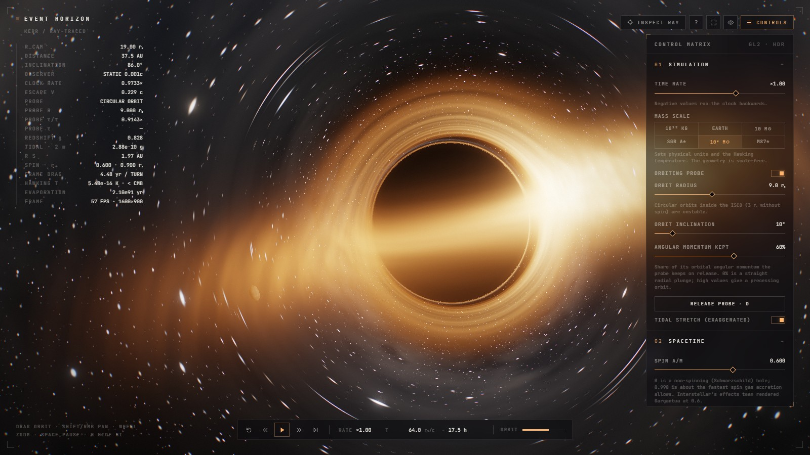
</p>

<p align="center"><sub><code>R_CAM 19.00 rₛ</code> · <code>INCLINATION 86.0°</code> · <code>CLOCK RATE 0.9733×</code> · <code>PROBE τ/t 0.9129</code></sub></p>

<br>

Every pixel is a photon traced **backwards** from the camera through curved spacetime around a non-rotating black hole. The arched halo, the thin photon ring and the lopsided glow of the disk are not painted on. They fall out of the geodesic equation, integrated on the GPU at interactive frame rates.

Built for learning: switch gravity off for light, swap the stars for a coordinate grid, draw the photon sphere and ISCO on the disk plane, and watch the readouts for how fast your clock runs.

<br>

## `00` &nbsp;LAUNCH

```bash
python -m http.server 5179
```

Then open **http://localhost:5179**. Opening `index.html` directly also works. Any browser with WebGL 2 will do (Chrome, Edge, Firefox, Safari 15+).

<br>

## `01` &nbsp;OBSERVATIONS

<table>
  <tr>
    <td width="50%">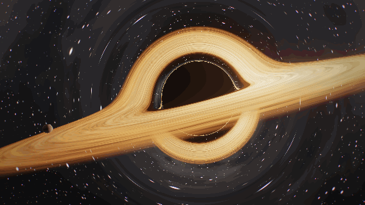</td>
    <td width="50%">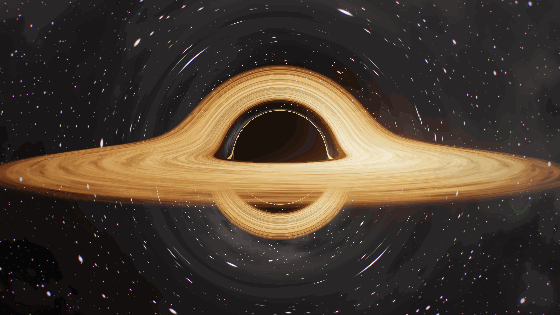</td>
  </tr>
  <tr>
    <td><sub><code>T → ∞</code> &nbsp;KEPLERIAN FLOW · INNER GAS LAPS THE OUTER DISK</sub></td>
    <td><sub><code>φ 0 → 2π</code> &nbsp;FREE CAMERA · ORBIT, PAN, ZOOM, ROLL</sub></td>
  </tr>
</table>

<table>
  <tr>
    <td width="50%">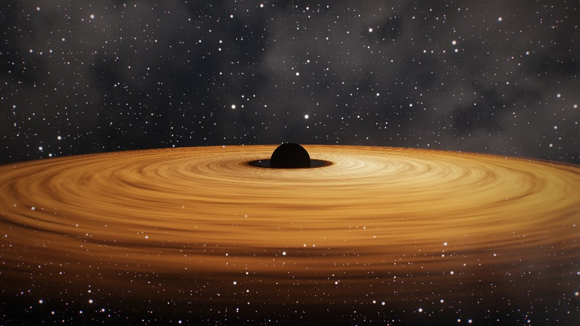</td>
    <td width="50%">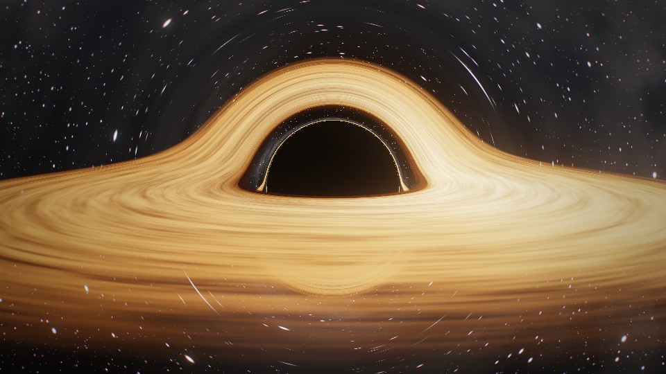</td>
  </tr>
  <tr>
    <td><sub><code>LIGHT BENDING 0%</code> &nbsp;FLAT SPACE · WHAT YOU WOULD NAIVELY EXPECT</sub></td>
    <td><sub><code>LIGHT BENDING 100%</code> &nbsp;THE FAR SIDE OF THE DISK, LIFTED OVER THE SHADOW</sub></td>
  </tr>
</table>

<p align="center">
  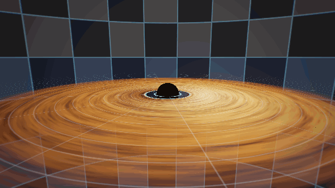
</p>
<p align="center"><sub><code>GRID</code> &nbsp;BACKGROUND + <code>EQUATORIAL GUIDES</code> · CYAN = PHOTON SPHERE 1.5 rₛ · AMBER = ISCO 3 rₛ</sub></p>

<table>
  <tr>
    <td width="50%">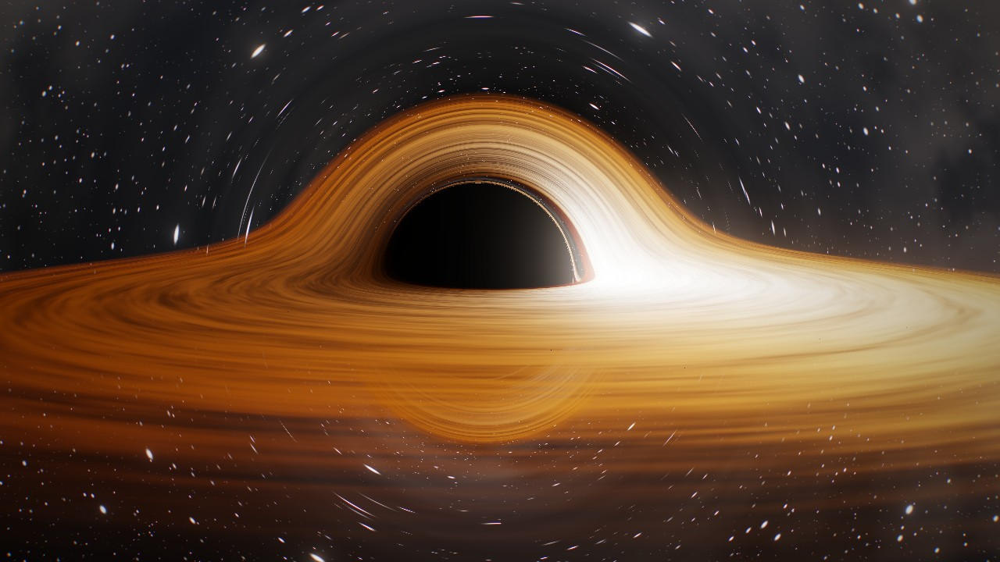</td>
    <td width="50%">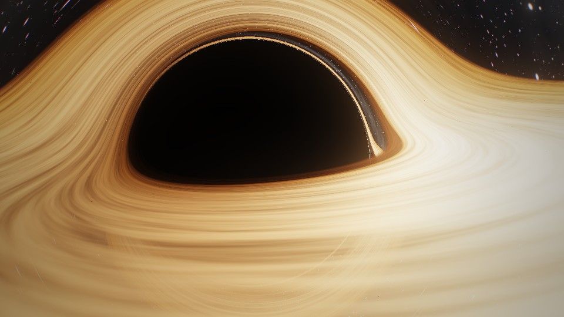</td>
  </tr>
  <tr>
    <td><sub><code>BLACKBODY</code> · <code>DOPPLER 100%</code> &nbsp;APPROACHING SIDE BEAMED, RECEDING SIDE DIMMED</sub></td>
    <td><sub><code>R_CAM 4.2 rₛ</code> &nbsp;CLOSE PASS · THE SHADOW FILLS THE SKY</sub></td>
  </tr>
  <tr>
    <td>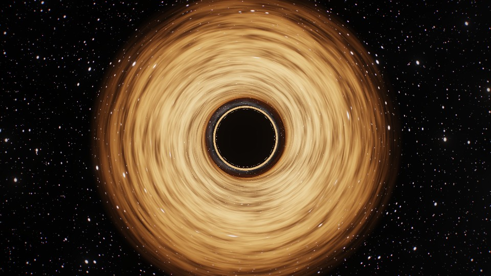</td>
    <td>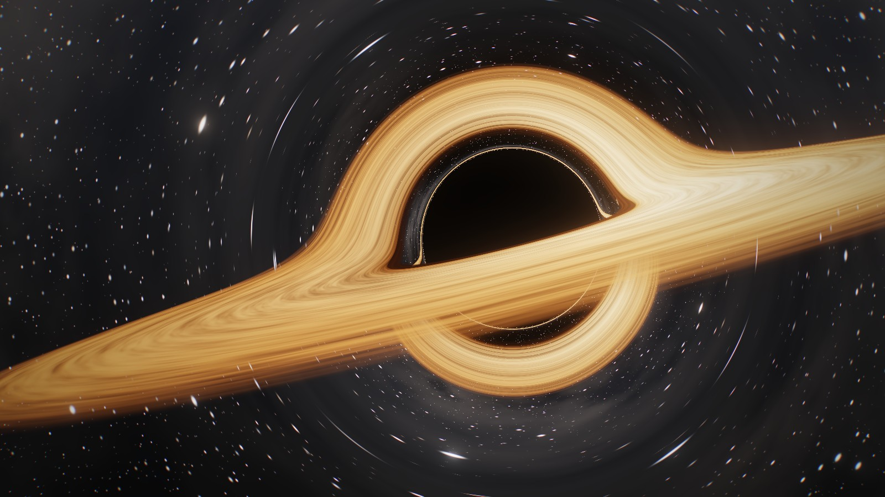</td>
  </tr>
  <tr>
    <td><sub><code>INCLINATION 3°</code> &nbsp;POLAR · THE PHOTON RING AS A PERFECT CIRCLE</sub></td>
    <td><sub><code>PRESET 1</code> &nbsp;GARGANTUA FRAMING · WITH ORBITING PROBE</sub></td>
  </tr>
</table>

<br>

## `02` &nbsp;EXPERIMENTS

### Drop the probe &nbsp;<sub><code>D</code></sub>

<table>
  <tr>
    <td width="50%">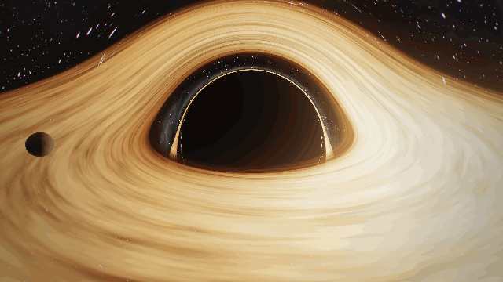</td>
    <td width="50%">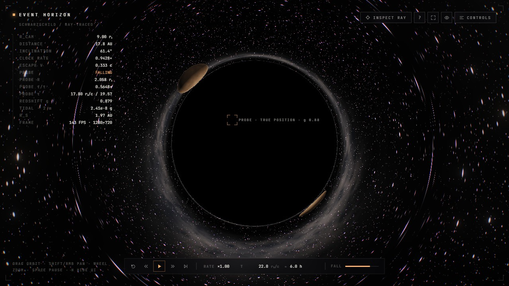</td>
  </tr>
  <tr>
    <td><sub><code>FALLING</code> &nbsp;SLOWS, REDDENS, FADES · NEVER SEEN TO CROSS</sub></td>
    <td><sub><code>TRUE POSITION</code> &nbsp;BEHIND THE SHADOW · SEEN AS TWO STRETCHED IMAGES</sub></td>
  </tr>
</table>

Release the orbiting probe and it follows a real free-fall path, solved with RK4 in its own proper time. Set *Angular momentum kept* to 0% for a straight plunge, or keep most of it for a precessing orbit. Two clocks disagree: the probe's own time **τ** reaches the horizon in a finite time, while from outside the probe slows, reddens and fades away (r − r<sub>s</sub> ∝ e<sup>−t</sup>). The **TIDAL · 2 m** readout gives the real stretching force on a 2 m body at the current mass scale: about 2×10⁷ g at the horizon of a 10 M☉ hole, about 2×10⁻⁷ g at the horizon of a 10⁸ M☉ one.

### Inspect a ray &nbsp;<sub><code>T</code></sub>

<p align="center">
  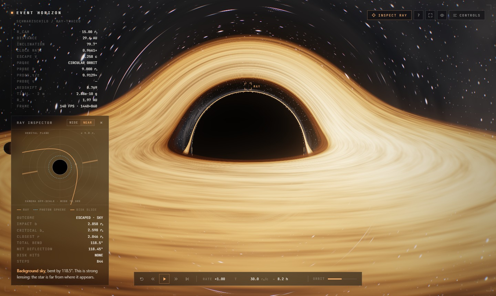
</p>

Click any pixel to trace its light ray backwards. A light ray around a non-rotating black hole always stays in one plane, and that plane contains both the camera and the hole, so a single 2D diagram shows the whole path. The panel reports where the ray ended up (horizon, sky, disk or probe), its impact parameter against the critical value b꜀ = 3√3⁄2 r<sub>s</sub>, the closest approach, and the total bending. It also says which image of the disk the pixel shows: primary, secondary, or a higher order inside the photon ring.

### Change the observer &nbsp;<sub><code>O</code></sub>

<table>
  <tr>
    <td width="50%">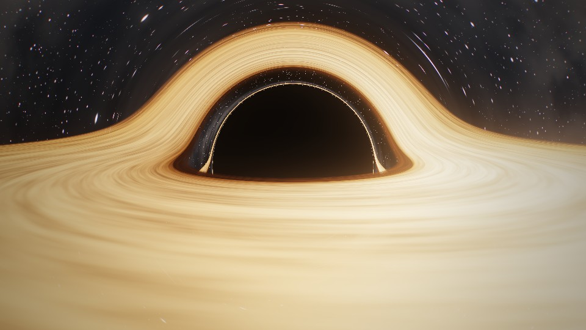</td>
    <td width="50%">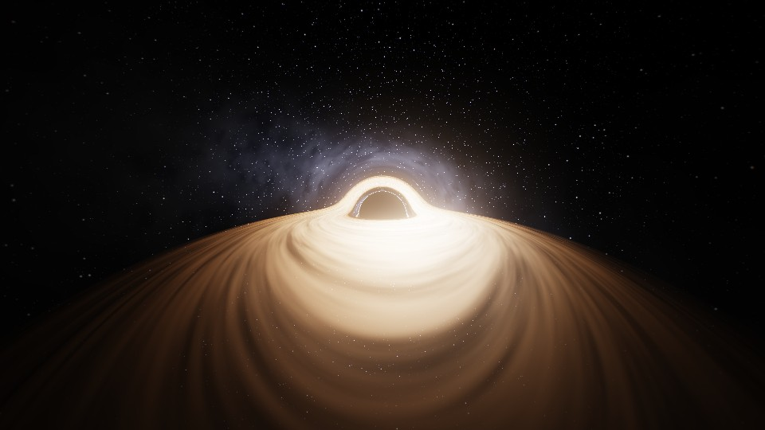</td>
  </tr>
  <tr>
    <td><sub><code>STATIC</code> &nbsp;HOVERING AT 8 rₛ</sub></td>
    <td><sub><code>BOOST 0.90c</code> &nbsp;SAME EVENT · THE SKY CROWDS FORWARD, AHEAD TURNS BLUE</sub></td>
  </tr>
  <tr>
    <td>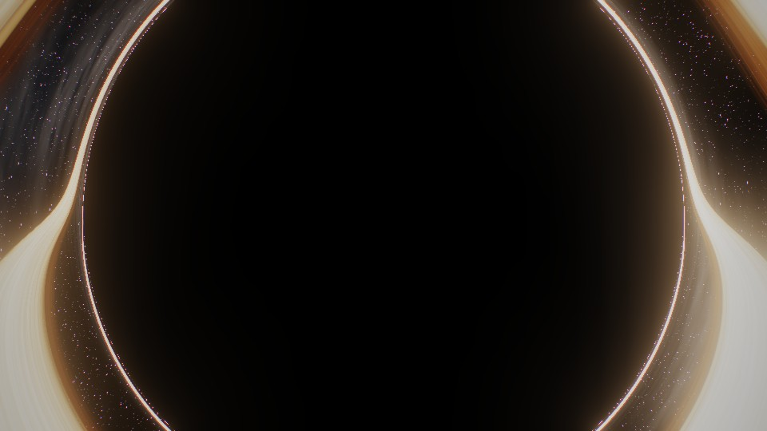</td>
    <td>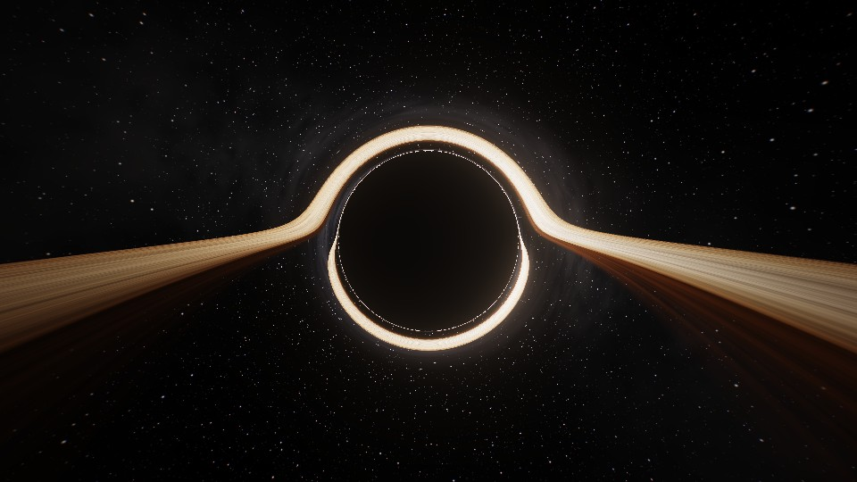</td>
  </tr>
  <tr>
    <td><sub><code>STATIC</code> &nbsp;HOVERING AT 2.2 rₛ · SHADOW ≈ 121° ACROSS</sub></td>
    <td><sub><code>FREE FALL 0.67c</code> &nbsp;PASSING 2.2 rₛ · THE SAME SHADOW, MUCH SMALLER</sub></td>
  </tr>
</table>

What you see depends on how you move. The camera can **hover**, ride a **circular orbit** at its current radius (0.5c at the ISCO, moving with simulation time), **fall freely** from rest at infinity (dr/dt = −(1 − r<sub>s</sub>/r)√(r<sub>s</sub>/r), reaching about 0.88c near the horizon), or **boost** toward the view at a set speed. Each pixel direction is aberrated into the static frame before tracing, and the Doppler factor D brightens the forward view (∝ D⁴, auto-exposed) and pushes it toward blue. The clock-rate readout follows the observer: √(1 − 1.5 r<sub>s</sub>/r) in orbit, 1 − r<sub>s</sub>/r in free fall.

<br>

## `03` &nbsp;INTERFACE

<p align="center">
  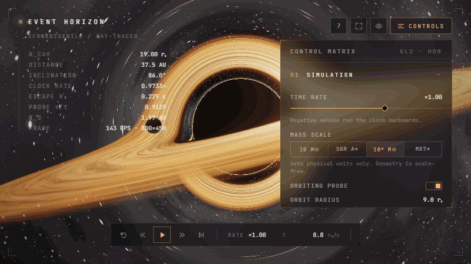
</p>

| &nbsp; | Region | Contents |
|:--|:--|:--|
| `▣` | **Telemetry** · top left | Camera radius, physical distance, inclination, observer mode and speed, observer clock rate, escape velocity; probe state, radius, clock rate, proper time, redshift and tidal force; Schwarzschild radius, Hawking temperature, evaporation time, frame rate |
| `⌖` | **Ray inspector** · left | Orbital-plane diagram of the clicked ray, its outcome and numbers, and a plain-language reading |
| `≡` | **Control matrix** · right | Six numbered sections: Simulation, Spacetime, Accretion Disk, Camera, Render, Export. Double-click a slider to reset it |
| `▶` | **Timeline** · bottom | Reset, slower/reverse, play/pause, faster, step, rate, simulation time in rₛ/c and in physical units, probe orbit phase |
| `?` | **Field notes** · top right | A short primer on every effect on screen |

<br>

## `04` &nbsp;PHYSICS

Units throughout: $r_s = 2GM/c^2 = 1$ and $c = 1$.

<table>
<tr><td width="34%"><code>GEODESICS</code></td><td>

Photon paths obey the Schwarzschild orbit equation. Written in Cartesian form, it becomes a force law that can be stepped with velocity Verlet, using a step size proportional to $r$:

$$\ddot{\mathbf{x}} = -\frac{3}{2}\,\frac{h^2\,\mathbf{x}}{r^5}, \qquad \mathbf{h} = \mathbf{x}\times\dot{\mathbf{x}}$$

</td></tr>
<tr><td><code>HORIZON · SHADOW</code></td><td>

Rays reaching $r = 1$ are captured. The visible shadow is larger, at $b_c = \tfrac{3\sqrt3}{2}\,r_s \approx 2.6\,r_s$, because rays below that impact parameter spiral in.

</td></tr>
<tr><td><code>PHOTON SPHERE</code></td><td>

At $r = 1.5\,r_s$ light can circle the hole. Rays that skim it stack up into the thin photon ring and the nested higher-order images of the disk.

</td></tr>
<tr><td><code>DISK · ISCO</code></td><td>

A thin disk in Keplerian rotation, $\Omega = \sqrt{GM/r^3}$, with a Novikov–Thorne-like temperature profile and an inner edge at the ISCO, $r = 3\,r_s$. A two-phase flow-map keeps differential shear from winding the texture up.

</td></tr>
<tr><td><code>DOPPLER · REDSHIFT</code></td><td>

Gas orbits at $\beta = \sqrt{0.5/(r-1)}$, which is about $0.5c$ at the ISCO. The observed intensity scales as $g^4$:

$$g = \frac{1}{\gamma\,(1-\beta\cos\theta)}\;\sqrt{\frac{1-1/r}{1-1/r_{cam}}}$$

</td></tr>
<tr><td><code>FREE FALL</code></td><td>

The probe integrates the timelike geodesic in proper time τ, with $M = \tfrac12$:

$$\frac{d^2r}{d\tau^2} = -\frac{M}{r^2} + \frac{L^2}{r^3} - \frac{3ML^2}{r^4}, \qquad \frac{dt}{d\tau} = \frac{E}{1 - r_s/r}$$

The renderer places it by coordinate time t, which diverges at the horizon. The tidal force is $\Delta a = 2GM\,\ell / R^3$.

</td></tr>
<tr><td><code>TIME DILATION</code></td><td>

A static clock runs at $\sqrt{1 - r_s/r}$. A clock on a circular orbit runs at $\sqrt{1 - 1.5\,r_s/r}$, which is the probe's <code>τ/t</code> readout. Below 3 rₛ its orbit is flagged <code>UNSTABLE</code>.

</td></tr>
<tr><td><code>OBSERVER</code></td><td>

A camera moving at $\boldsymbol\beta$ relative to a local static observer sees a pixel direction $\hat s'$ that the static frame calls

$$\hat s \propto \hat s' + (\gamma - 1)(\hat s'\!\cdot\hat\beta)\,\hat\beta - \gamma\boldsymbol\beta, \qquad D = \frac{1}{\gamma\,(1 - \boldsymbol\beta\cdot\hat s')}$$

Rays are traced from $\hat s$. The image is scaled by $D^4$ and divided by $D_{max}^3$ for exposure.

</td></tr>
<tr><td><code>HAWKING</code></td><td>

$$T_H = \frac{\hbar c^3}{8\pi G M k_B} \approx 6.17\times10^{-8}\,\mathrm{K}\;\frac{M_\odot}{M}, \qquad t_{evap} \approx 2.1\times10^{67}\,\mathrm{yr}\left(\frac{M}{M_\odot}\right)^3$$

Every astrophysical hole is far colder than the 2.7 K microwave background. The *10¹² kg* primordial preset sits at about 10¹¹ K.

</td></tr>
</table>

<br>

## `05` &nbsp;CONTROLS

| Input | Action | &nbsp; | Key | Action |
|:--|:--|:-:|:-:|:--|
| `drag` | orbit | | `Space` | play / pause |
| `shift` / `RMB` drag | pan (off-axis) | | `[` `]` | time rate − / + |
| `wheel` / pinch | zoom | | `,` `.` | step back / forward |
| `← ↑ → ↓` | orbit | | `0` | reset time |
| `+` `−` | dolly | | `1`–`4` | camera presets |
| double-click | Gargantua preset | | `G` | equatorial guides |
| click *(inspect mode)* | trace that pixel's ray | | `D` | release / recall probe |
| | | | `T` | ray inspector |
| | | | `O` | cycle observer mode |
| | | | `P` | PNG snapshot |
| | | | `R` | record / stop |
| | | | `H` · `C` · `I` · `F` | hide UI · panel · notes · fullscreen |

<details>
<summary><b>Parameter reference</b></summary>
<br>

| Section | Parameter | Range | Notes |
|:--|:--|:--|:--|
| Simulation | Time rate | −4× … 4× | Negative runs time backwards |
| | Mass scale | 10¹² kg · Earth · 10 M☉ · Sgr A* · 10⁸ M☉ · M87* | Physical units and Hawking temperature; the geometry is scale-free |
| | Probe orbit | 2 – 18 rₛ, 0 – 80° | Circular geodesic, lensed like everything else |
| | Angular momentum kept | 0 – 98% | Share of orbital L kept on release |
| | Tidal stretch | on / off | Visual, exaggerated; the telemetry gives the real value |
| Spacetime | Light bending | 0 – 100% | Multiplies the geodesic curvature |
| | Doppler beaming | 0 – 100% | Scales the disk velocity used for beaming |
| | Gravitational redshift | on / off | |
| | Background | Stars · Grid · Void | |
| Accretion disk | Palette | Cinematic · Blackbody | Blackbody also sets Doppler to 100% |
| | Temperature, inner/outer edge, luminosity, optical depth, turbulence, rotation | | |
| Camera | Observer | Static · Orbit · Free fall · Boost | Aberration and Doppler from the camera's own motion |
| | Boost speed | 0 – 0.95c | Boost mode only |
| | Follow trajectory, observer beaming | on / off | Orbit and fall move with simulation time |
| | Presets, FOV, roll, auto-orbit | | |
| Render | Integrator | Low · Med · High · Ultra | Step size and step budget per ray |
| | Resolution, bloom, exposure, star field, vignette, grain | | |

</details>

<br>

## `06` &nbsp;EXPORT

| Output | Format | Options |
|:--|:--|:--|
| **Snapshot** | PNG at canvas resolution | key `P` |
| **Clip** | MP4 (H.264), or WebM where MP4 recording isn't supported | Viewport · 720p · 1080p · 4K · 5 / 10 / 30 s or manual · 30 / 60 fps |

Clips are encoded in real time with `MediaRecorder`. Fixed output sizes resize the canvas while recording. For smooth 4K, lower *Resolution* or *Integrator* first.

<br>

## `07` &nbsp;CONSOLE API

```js
EventHorizon.set({ sky: 'grid', guides: true, gravity: 0.5 });
EventHorizon.preset('edge');          // gargantua · edge · top · close
EventHorizon.camera.dist = 6;         // eased; call snapCamera() to jump
EventHorizon.time = 0;
EventHorizon.releaseProbe();          // resetProbe() to recall it
EventHorizon.inspect(640, 300);       // trace the ray at CSS pixel (x, y)
EventHorizon.set({ observer: 'boost', obsBeta: 0.9 });
EventHorizon.snapshot();
```

<br>

## `08` &nbsp;STRUCTURE

```
index.html        HUD markup, field notes
css/style.css     interface
js/shaders.js     geodesic tracer, disk, sky, bloom, tone mapping (GLSL ES 3.0)
js/main.js        render graph, camera, observer modes, probe geodesic, ray inspector, UI, export
docs/             README media
```

The render graph has three stages. The **scene pass** traces rays into a half-float target at a scalable resolution. A five-level **bloom** chain follows (prefilter, downsample, separable blur). The **composite** applies ACES tone mapping, vignette, subtle chromatic aberration and grain.

<br>

<p align="center">
  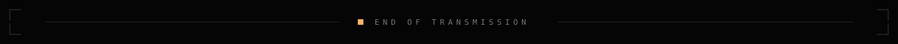
</p>
